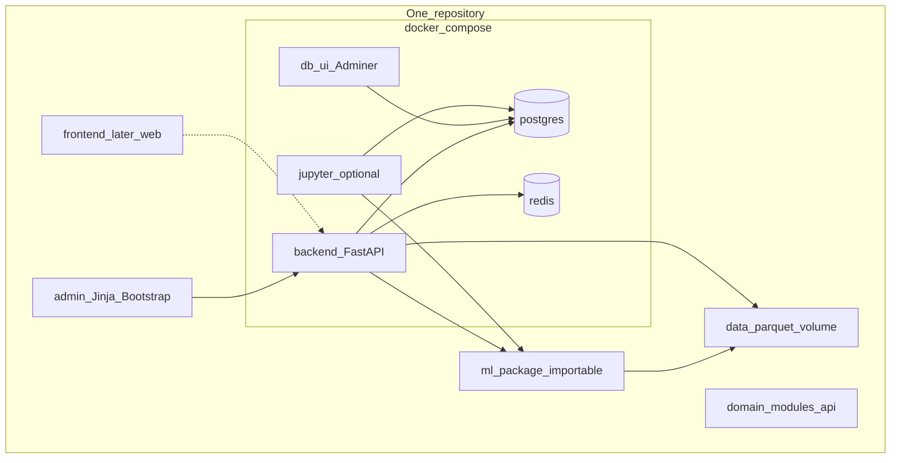
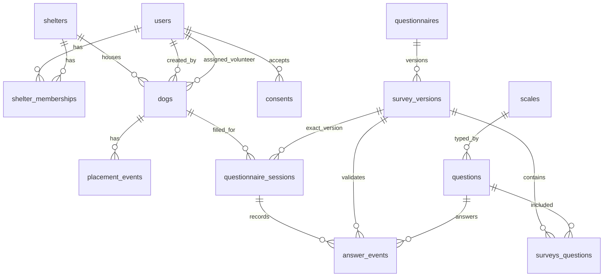

# Research data app — внутреннее приложение сбора данных

Концепция внутреннего (expert/admin) контура.

## Для чего

Наполнение БД для обучения моделей и разметки **до** owner-facing продукта.
На этапе исследования данные в базу будем заносить через бот в ТГ. Новый владелец заполняет анкету; админ управляет данными и рассылками. Это не K5-чат и не приложение для усыновителя.

Источник схемы: [app-ideas-notes](../sources/app-ideas-notes.md) (`_app_ideas/_database_architecture.md`).

## Архитектура MVP

**Modular monolith:** один продуктовый репозиторий, один backend FastAPI, один `docker compose up`. Микросервисы не делаем. Границы — доменные Python-модули, пакет `app.admin` (HTML) и пакет `app.ml`. React — только будущий пользовательский `web/`.

Knowledge wiki (`barko-docs`) остаётся отдельно от кода приложения (`MIPT/startup/hvostun-core`).

Основа: официальный [Full Stack FastAPI Template](https://github.com/fastapi/full-stack-fastapi-template) для backend/auth. Продуктовая админка — **не** dashboard шаблона и **не** FastAdmin: FastAPI + Jinja2 + Bootstrap в `backend/app/admin`. JSON `/api/v1` в `backend/app/api` зарезервирован для `web/`.



| Контейнер в compose | Роль |
|---------------------|------|
| `db` | PostgreSQL — единственная OLTP-БД |
| `backend` | FastAPI + SQLModel + Alembic: HTML-админка + JSON `/api/v1` |
| `db-ui` | Adminer — локальный просмотр БД, не продуктовая админка |
| `redis` | кэш / Celery broker позже |
| `jupyter` (опционально) | Ноутбуки поверх того же `ml/` и той же БД |
| `worker` (позже) | Celery из того же образа |

**Правило:** новая фича = доменный модуль или `app.ml.*`, не новый HTTP-сервис.

### Структура репозитория (ориентир)

```text
MIPT/startup/hvostun-core/
  compose.yml
  backend/
    app/
      api/routes/        # JSON /api/v1 для будущего web/
      admin/             # Jinja + Bootstrap, HTML-роуты
      domains/
      ml/
    alembic/
    notebooks/
    pyproject.toml
  frontend/              # заготовка React для web/ (ещё не подключена)
  data/
```

## Стек

| Слой | Выбор |
|------|--------|
| Bootstrap проекта | [full-stack-fastapi-template](https://github.com/fastapi/full-stack-fastapi-template) |
| DB | PostgreSQL |
| ORM / migrations | SQLModel/SQLAlchemy + Alembic |
| Backend | FastAPI + Pydantic |
| Auth | JWT из шаблона; админка — httpOnly cookie; API — Bearer. `is_superuser` + позже memberships |
| API | FastAPI + OpenAPI в `backend/app/api`; generated client — когда появится `web/` |
| Admin UI | Jinja2 + Bootstrap в `backend/app/admin` |
| Web UI | React + TypeScript + Vite + Tailwind/shadcn; исходник `frontend/`, каталог `web/` позже |
| DB UI | Adminer (`db-ui`), только local |
| Deploy | Один Compose: `backend` + `db` + `db-ui` (+ later `redis` / `jupyter`) |

`fastapi-users` не добавляем: auth уже реализован в официальном шаблоне, а библиотека находится в maintenance mode. FastAdmin и CRUDAdmin не берём: админка — свои HTML-страницы.

**Не брать на MVP:** микросервисы, Mongo/ClickHouse/lake, отдельные репозитории frontend/backend/ml, второй auth framework, PyTorch до tabular baseline.

## Ops vs training

Один Postgres + файлы в `data/`. Open subsets — через `ml.ingest`; anonymized export — `ml.export`. См. [data-harmonization](data-harmonization.md).

## Модель данных

Канон из `_database_architecture.md` с уточнениями для миграций.



### Организации и доступ

| Таблица | Поля (суть) | Заметки |
|--------|-------------|---------|
| `shelters` | id, name, description, address, contact_info, timestamps | Без `owner_id` |
| `shelter_memberships` | user_id, shelter_id, member_role (`employee` \| `volunteer` \| `director`), timestamps | Object-scope «свой приют» |
| `users` | id, name, email, phone, contact, `is_superuser`, timestamps | Системный superuser из шаблона; object-scope — через memberships и API permissions |

### Собаки и placement (лейблы K3)

| Таблица | Поля (суть) | Заметки |
|--------|-------------|---------|
| `dogs` | name, sex, neutered, status, description, shelter_id, assigned_volunteer_id, owner_id (adopter, nullable), birthday, `status_at`, breed, mixed, created_by_id, **provenance**, timestamps | `status`: `shelter` / `home` / `back_shelter` / `overexposure`; `status_at` — дата текущего статуса, не замена `placement_events` |
| `placement_events` | dog_id, code (`shelter_started` / `home_started` / `back_shelter` / `overexposure_started`), created_at | Как HelpDog: [helpdog-forum-adoptions](../datasets/helpdog-forum-adoptions.md); несколько циклов на собаку |

### Согласия (152-ФЗ)

| Таблица | Поля |
|--------|------|
| `consents` | user_id, type, accepted_at, version |

Нормы и чеклист: [personal-data-152-fz](personal-data-152-fz.md), саммари закона — [fz-152-personal-data](../sources/fz-152-personal-data.md). PII только в ops; training — обезличенный export.

### Анкеты

| Таблица | Поля (суть) | Заметки |
|--------|-------------|---------|
| `surveys` | id, name, **slug** (`cbarq_s_42`, `cbarq_long_100`, позже shelter-cbarq), description, timestamps | Редактируемая карточка анкеты |
| `survey_versions` | id, survey_id, version_num, description, created_at | Immutable-версия; unique `(survey_id, version_num)` |
| `scales` | type, config JSON (`min_value`, `max_value`, `legend`) | `integer` / `text` / `date`; immutable; ключи legend — строки |
| `questions` | id, global_id, text, scale_id, timestamps | Immutable; `global_id` стабилен между версиями |
| `surveys_questions` | survey_version_id, question_id, order_num, user_id, created_at | Состав и порядок конкретной версии; после первой session нельзя добавлять строки |
| `survey_sessions` | owner_id, dog_id, survey_version_id, status (`draft` \| `finished` \| `canceled`), client_metadata, timestamps | Session всегда указывает на точную версию |
| `answer_events` | surveys_session_id, survey_version_id, question_id, value JSONB, created_at | Append-only; composite FK гарантируют принадлежность вопроса версии |

`Scale.config` и `AnswerEvent.value` валидируются ORM. Канон ответа:
`{"value": ...}`. Integer проверяется по `min_value` / `max_value` и
`legend`, text — строка, date — ISO date.

Каталоги `survey_versions`, `questions`, `scales`, `recommendations` и
`answer_events` immutable на ORM-уровне. Все FK используют `ON DELETE
RESTRICT`; зависимости удаляются только явно. Raw SQL/Adminer и bulk DML
обходят ORM guard и не используются для изменения каталогов.

`domain_scores` на MVP считать в `app.ml.export`, не обязательно хранить в OLTP. Для административных изменений нужен audit (отдельные audit events, не FastAdmin hooks).

Не смешивать open-import с живыми собаками без `provenance` (`hvostun_ops` \| `padova` \| `wolfram` \| …).

## Роли (MVP)

| Роль | Может | Реализация |
|------|--------|------------|
| Волонтёр | CRUD собак своего приюта (через membership); анкета частями; динамика ответов | `shelter_memberships` + FastAPI permission dependencies |
| Админ | Пользователи, memberships, приюты, каталог анкет | `is_superuser` / app-role + internal admin |
| Эксперт | Read + заметки | **Отложено** |

## Порядок работ (v0)

1. Официальный Full Stack FastAPI Template + Redis + `app.ml/`.
2. Существующий auth + memberships/permissions + `consents`.
3. SQLModel-модели и Alembic-миграции; seed C-BARQ(S) 42 пункта.
4. HTML-админка (`backend/app/admin`): списки собак/анкет/сессий; Adminer для сырой БД.
5. React-анкета в `web/` (draft/finish, история `answer_events`); JSON API уже в `backend/app/api`.
6. `app.ml.export` → Parquet; `app.ml.ingest` для open subsets.

**Критерий v0:** `docker compose up`; волонтёр завёл собаку, заполнил анкету в 2 захода с правкой ответа; админ выдал доступ; есть выгрузка для K3.

## Предусмотреть заранее

- Версии/slug опросника; Shelter C-BARQ как отдельный `slug` при необходимости.
- Placement events → таргет возврата для [K3](../components/k3-risk-prediction.md).
- PII только в ops; в training — hash dog_id + ответы.
- Лицензия C-BARQ — research UI/export без публичного dump item-текстов.
- Напоминания о статусе пристройства (бот) — позже, не блокирует схему.
- Один Python lockfile (`uv.lock`) для backend/ML/Jupyter.
- Adminer, Jupyter и Redis не публикуются в production.

## Отложено

- Экспертный контур и `expert_notes`
- Микросервисы; ClickHouse/Mongo; merge open+own в UI
- K5 / owner UX (модули в том же монолите позже)
- Celery worker до появления реальной фоновой задачи
- **Мост K5→анкета + сравнение каналов** (Яндекс.Форма vs Амелько; поле `channel` на sessions) — может быть отдельный сервис сбора: [k5-k3-answer-bridge](k5-k3-answer-bridge.md)

## Связанные страницы

- [app-ideas-notes](../sources/app-ideas-notes.md)
- [c-barq](c-barq.md)
- [personal-data-152-fz](personal-data-152-fz.md)
- [fz-152-personal-data](../sources/fz-152-personal-data.md)
- [data-harmonization](data-harmonization.md)
- [k3-risk-prediction](../components/k3-risk-prediction.md)
- [mvp-verifiable-metrics](../ml/mvp-verifiable-metrics.md)
- [helpdog-forum-adoptions](../datasets/helpdog-forum-adoptions.md)
- [adoption-return](adoption-return.md)
- [k5-k3-answer-bridge](k5-k3-answer-bridge.md) — roadmap каналов сбора и extract из K5
